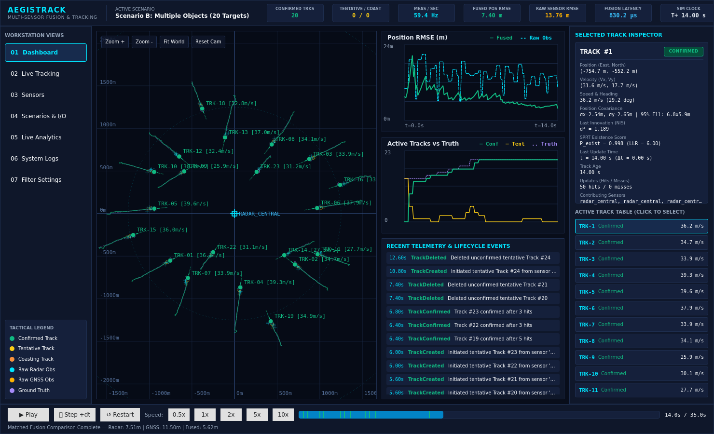
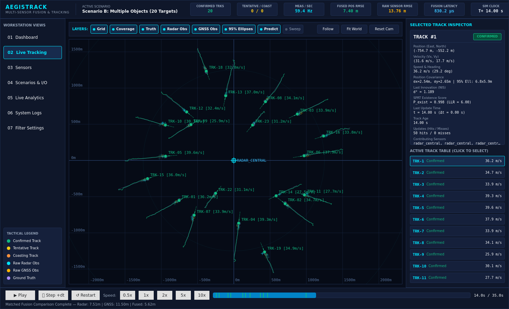
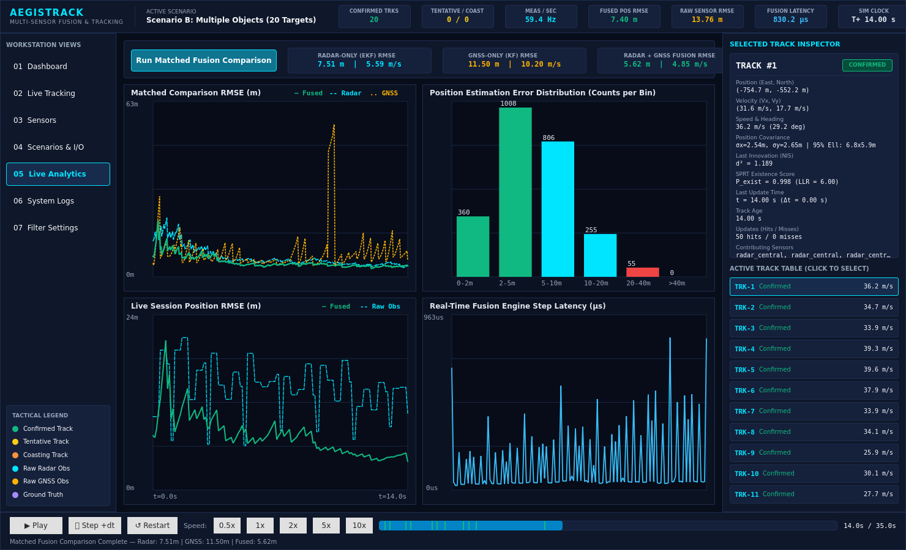
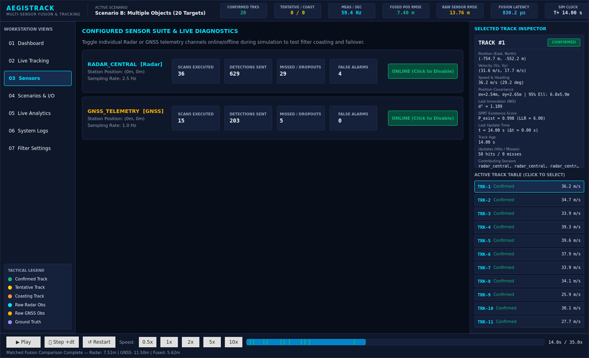
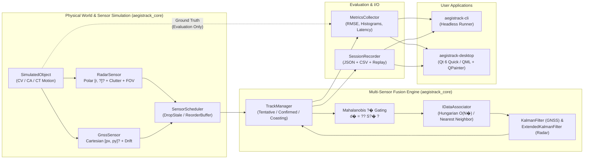

# AegisTrack - Multi-Sensor Fusion & Real-Time Object Tracking System

[](CMakeLists.txt)
[](CMakePresets.json)
[](ui/qml/Main.qml)
[](.github/workflows/ci.yml)
[](LICENSE)

**AegisTrack** is a modular, real-time 2D multi-sensor fusion and multi-object tracking system written in **Modern C++20**, **Eigen 3**, and **Qt 6 Quick / QML**.

Designed as a production-inspired civilian simulation and evaluation workstation, AegisTrack models multi-target kinematics (`ConstantVelocity`, `ConstantAcceleration`, `CoordinatedTurn`), asynchronous heterogeneous sensors (`RadarSensor` polar $[r, \theta]^T$ with Poisson clutter/occlusion and `GnssSensor` Cartesian $[p_x, p_y]^T$ with bias/drift and packet loss), out-of-sequence measurement (OOSM) scheduling, **Linear and Extended Kalman Filtering (KF / EKF)** with Joseph-stabilized covariance updates, **Mahalanobis $\chi^2$-gated Hungarian global data association**, **Sequential Probability Ratio Test (SPRT)** track lifecycle management, and real-time accuracy/latency analytics.

---

## Workstation Visual Overview

### 1. Command Dashboard Overview

*Unified command view combining the interactive 2D tactical canvas, real-time Position RMSE and track lifecycle charts, chronological event log, and Selected Track Inspector.*

### 2. Full-Workspace Live Tracking & Layer Controls

*Interactive 2D Cartesian (East-North) tracking canvas displaying confirmed tracks, velocity vectors, 95% confidence covariance ellipses, raw Radar/GNSS observations, and ground-truth trajectories.*

### 3. Multi-Sensor Fusion Analytics & Matched Comparison

*Matched ground-truth evaluation comparing Radar-Only (EKF) vs. GNSS-Only (Linear KF) vs. Multi-Sensor Radar+GNSS Fusion, alongside estimation error histograms and sub-millisecond fusion step latency.*

### 4. Sensor Suite Health & Interactive Failover Controls

*Per-sensor telemetry diagnostics and live online/offline failover controls for testing filter coasting and track re-acquisition.*

---

## System Architecture

The core simulation, sensor modeling, state estimation, data association, and track lifecycle engine (`aegistrack_core`) is strictly decoupled from Qt 6 and compiles standalone in headless environments.



### Strict Ground-Truth Isolation
Ground-truth object states (`SimulatedObject`) are **never** exposed to `FusionEngine`, `TrackManager`, `IDataAssociator`, or `IStateEstimator`. Only `ISensor::generateMeasurements` (to synthesize noisy detections) and `MetricsCollector` (post-step evaluation) read ground truth. This architectural boundary is enforced at compile time and verified in [`tests/unit/test_scenarios_and_architecture.cpp`](tests/unit/test_scenarios_and_architecture.cpp).

---

## Mathematical Highlights

Full derivations are documented in [`docs/mathematics.md`](docs/mathematics.md) and [`docs/algorithms.md`](docs/algorithms.md):

1. **State Vector & Continuous White-Acceleration Process Noise**:
   $$\mathbf{x}_k = \begin{bmatrix} p_x & p_y & v_x & v_y \end{bmatrix}^T, \quad \mathbf{Q}(\Delta t) = \sigma_a^2 \begin{bmatrix} \frac{1}{4}\Delta t^4 & 0 & \frac{1}{2}\Delta t^3 & 0 \\ 0 & \frac{1}{4}\Delta t^4 & 0 & \frac{1}{2}\Delta t^3 \\ \frac{1}{2}\Delta t^3 & 0 & \Delta t^2 & 0 \\ 0 & \frac{1}{2}\Delta t^3 & 0 & \Delta t^2 \end{bmatrix}$$

2. **Nonlinear Polar Radar Measurement Model & EKF Jacobian**:
   $$h(\mathbf{x}) = \begin{bmatrix} r \\ \theta \end{bmatrix} = \begin{bmatrix} \sqrt{\Delta x^2 + \Delta y^2} \\ \operatorname{atan2}(\Delta y, \Delta x) \end{bmatrix}, \quad \mathbf{H}_k = \begin{bmatrix} \frac{\Delta x}{r} & \frac{\Delta y}{r} & 0 & 0 \\ -\frac{\Delta y}{r^2} & \frac{\Delta x}{r^2} & 0 & 0 \end{bmatrix}$$
   Bearing residuals are wrapped via $\nu_\theta = \operatorname{wrapAnglePi}(z_\theta - \hat{\theta}) \in (-\pi, \pi]$ so tracks crossing the $\pm\pi$ branch cut never suffer $2\pi$ innovation spikes.

3. **Cholesky Kalman Gain & Joseph Stabilized Covariance Update**:
   Instead of computing explicit matrix inverses (`.inverse()`), AegisTrack solves $\mathbf{S}_k \mathbf{K}_k^T = \mathbf{H}_k \mathbf{P}_{k|k-1}^T$ via `Eigen::LLT` (with `Eigen::LDLT` fallback) and updates covariance via the symmetric positive-definite Joseph form:
   $$\mathbf{P}_{k|k} = (\mathbf{I} - \mathbf{K}_k \mathbf{H}_k)\mathbf{P}_{k|k-1}(\mathbf{I} - \mathbf{K}_k \mathbf{H}_k)^T + \mathbf{K}_k \mathbf{R}_k \mathbf{K}_k^T$$

4. **Mahalanobis $\chi^2$ Gating & Global Hungarian Assignment**:
   Candidate track-to-measurement pairs are gated using $d^2 = \boldsymbol{\nu}^T \mathbf{S}^{-1} \boldsymbol{\nu} \le \gamma_{\chi^2}$ (default $\gamma = 9.2103$ for 99% confidence in 2D) and globally assigned via an exact $O(N^3)$ Jonker-Volgenant / Kuhn-Munkres solver augmented with per-track dummy unassigned columns.

---

## Performance & Fusion Evaluation

The benchmark suite covers filtering, association, track updates, and end-to-end simulation at 1, 10, 50, and 100 objects. Run it on your machine to obtain reproducible timings:

```bash
cmake --preset headless
cmake --build --preset headless
ctest --preset headless --output-on-failure
./build/headless/aegistrack_benchmarks --benchmark_min_time=0.05s
./build/headless/aegistrack-cli --scenario scenarios/fusion-comparison.json --fusion-comparison
```

Timing and RMSE values depend on the machine, scenario, and code revision. Previously recorded values were removed after changing capture-time sampling and error evaluation; fresh results should accompany a tagged release with the exact commit, toolchain, and command.

---
## Building & Running AegisTrack

### Prerequisites
- **Compiler**: C++20 compiler (`GCC 12+`, `Clang 15+`, or `MSVC 2022`)
- **Build System**: `CMake 3.24+` and `Ninja`
- **Core Dependencies**: `Eigen3`, `spdlog`, `nlohmann_json`, `GTest`, `benchmark`
- **Desktop GUI Dependencies** *(optional for headless builds)*: `Qt6` (`Core`, `Gui`, `Quick`, `Qml`, `QuickControls2`)

On Ubuntu 24.04 / WSL2:
```bash
sudo apt-get update && sudo apt-get install -y \
  cmake ninja-build g++ \
  libeigen3-dev libspdlog-dev nlohmann-json3-dev \
  libgtest-dev libgmock-dev libbenchmark-dev \
  qt6-base-dev qt6-declarative-dev \
  qml6-module-qtquick qml6-module-qtquick-controls \
  qml6-module-qtquick-layouts qml6-module-qtquick-window \
  qml6-module-qtqml-workerscript
```

### 1. Build & Run Full Workstation (Core + CLI + Qt 6 Desktop + Tests + Benchmarks)
```bash
cmake --preset default
cmake --build --preset default -j

# Launch the interactive Qt 6 Desktop Workstation
./build/default/aegistrack-desktop
```

### 2. Build & Run Headless Mode (No Qt Dependency Required)
```bash
cmake --preset headless
cmake --build --preset headless -j

# Run a scenario with matched Radar-only vs GNSS-only vs Fused comparison and export CSV/JSON
./build/headless/aegistrack-cli \
  --scenario scenarios/fusion-comparison.json \
  --fusion-comparison \
  --export exports/fusion_run

# Deterministically replay a recorded session with Nearest-Neighbor vs Hungarian association
./build/headless/aegistrack-cli \
  --replay exports/fusion_run/session.json \
  --associator Hungarian
```

### 3. Run Automated Unit & Integration Tests (30 Tests)
```bash
ctest --preset default --output-on-failure
```

### 4. Run AddressSanitizer & UndefinedBehaviorSanitizer Suite
```bash
cmake --preset sanitizers
cmake --build --preset sanitizers -j
ctest --preset sanitizers --output-on-failure
```

### 5. Run Google Benchmark Suite
```bash
./build/default/aegistrack_benchmarks --benchmark_min_time=0.05s
```

---

## Built-In Scenarios (`scenarios/`)

| Scenario File | Code | Engineering Purpose |
|---|---|---|
| [`basic.json`](scenarios/basic.json) | **Scenario A** | Single-aircraft constant-velocity baseline verification |
| [`multiple_objects.json`](scenarios/multiple_objects.json) | **Scenario B** | 20 independent targets with staggered spawns and velocities |
| [`crossing.json`](scenarios/crossing.json) | **Scenario C** | 4 symmetric intersecting trajectories testing velocity-state gating |
| [`noisy_measurements.json`](scenarios/noisy_measurements.json) | **Scenario D** | High-variance radar & GNSS noise (`?_r=22m, ?_gnss=28m`) filter smoothing |
| [`sensor_failure.json`](scenarios/sensor_failure.json) | **Scenario E** | Scheduled radar (`12-20s`) and GNSS (`24-30s`) outages & failover |
| [`occlusion.json`](scenarios/occlusion.json) | **Scenario F** | Circular radar shadow zone (`r=190m`) testing track coasting & recovery |
| [`dense_environment.json`](scenarios/dense_environment.json) | **Scenario G** | 25 closely spaced targets with elevated Poisson clutter (`?=2.0/scan`) |
| [`stress.json`](scenarios/stress.json) | **Scenario H** | 80 simultaneous targets tracked by dual radar stations + GNSS |
| [`fusion-comparison.json`](scenarios/fusion-comparison.json) | **Scenario I** | Matched ground-truth Radar-Only vs. GNSS-Only vs. Fused evaluation |
| [`dynamic_maneuvers.json`](scenarios/dynamic_maneuvers.json) | **Scenario J** | Piecewise scheduled `CV` $\rightarrow$ `CoordinatedTurn` $\rightarrow$ `CA` maneuvers |

---

## Documentation Index

- [**Architecture & Threading Model**](docs/architecture.md)
- [**Mathematical Foundations & Filter Equations**](docs/mathematics.md)
- [**Data Association, OOSM & Track Lifecycle Algorithms**](docs/algorithms.md)
- [**Testing Strategy & Verification Matrix**](docs/testing.md)
- [**Performance Benchmarks & Optimization Report**](docs/performance.md)
- [**Architectural Design Decisions & Tradeoffs**](docs/design-decisions.md)
- [**Implementation Status**](IMPLEMENTATION_STATUS.md) & [**Future Roadmap**](ROADMAP.md)
