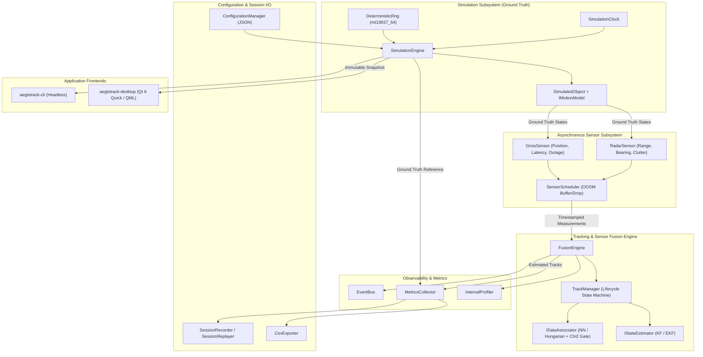
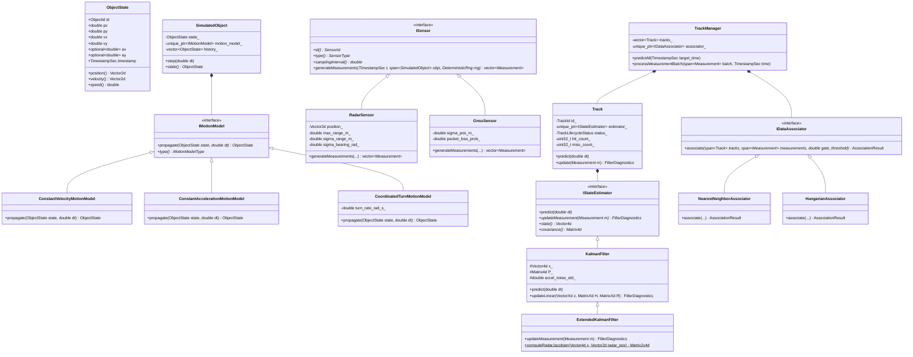
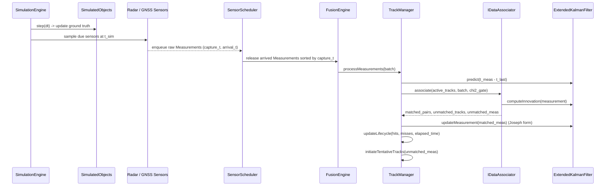
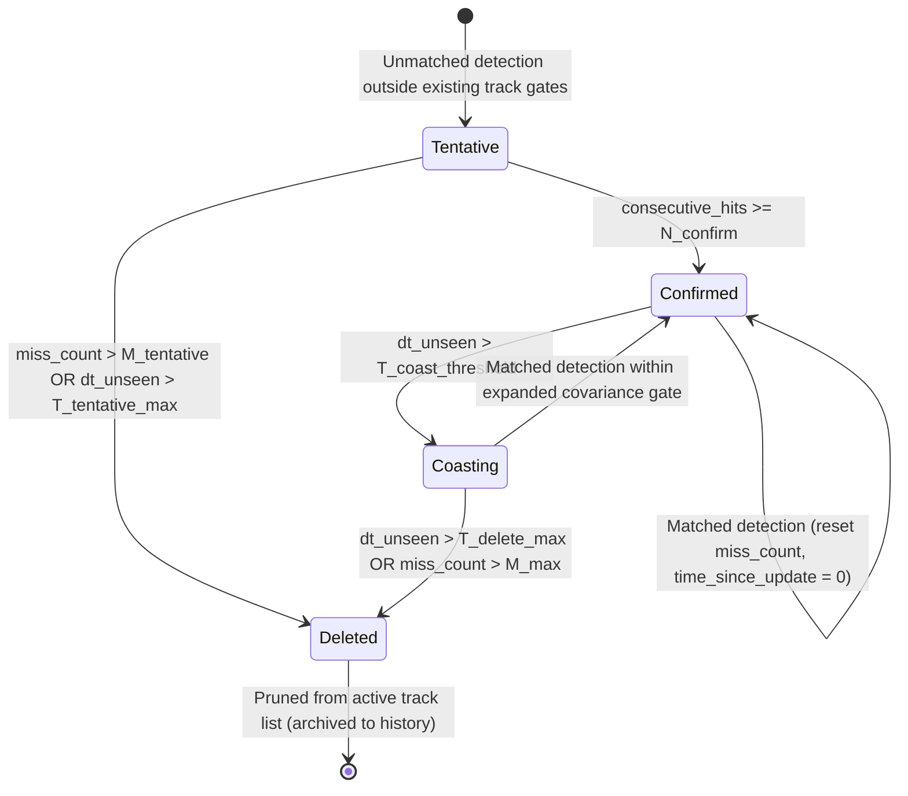

# AegisTrack Architecture Specification

## 1. Architectural Overview

**AegisTrack** is a modular, real-time 2D multi-sensor fusion and multi-object tracking system implemented in Modern C++20. The architecture enforces a strict separation between:

1. **Physical World Simulation (`aegistrack::simulation`)** — Ground-truth object kinematics, trajectory history, and scenario scheduling.
2. **Synthetic Sensor Models (`aegistrack::sensors`)** — Radar (nonlinear polar range-bearing with false alarms) and GNSS (linear Cartesian telemetry with packet dropouts and latency), scheduled asynchronously.
3. **Estimation, Association & Fusion Core (`aegistrack::filtering`, `aegistrack::association`, `aegistrack::tracking`, `aegistrack::fusion`)** — Linear Kalman Filter (KF), Extended Kalman Filter (EKF), Mahalanobis-gated Nearest Neighbor and Hungarian assignment, and time-aware track lifecycle management.
4. **Telemetry, Recording & Evaluation (`aegistrack::metrics`, `aegistrack::io`, `aegistrack::events`)** — Ground-truth-to-track evaluation (RMSE, error distributions, latency profiling) and deterministic session recording/replay.
5. **Presentation Layers (`apps/cli`, `apps/desktop`)** — Headless command-line runner and Qt 6 Quick / QML engineering dashboard communicating via immutable thread-safe state snapshots.

> [!IMPORTANT]
> The core library (`aegistrack_core`) has **zero dependency on Qt**. Ground truth (`ObjectId`, `SimulatedObject`) is never accessible to `IDataAssociator`, `TrackManager`, or `IStateEstimator`; it is strictly isolated to `SimulationEngine`, `ISensor::generateMeasurements`, and `MetricsCollector`.

---

## 2. High-Level Component Diagram

---

## 3. UML Class Diagram (Core Domain)

---

## 4. Coordinate System and Units

All physical quantities inside `aegistrack_core` use SI units in a local 2D East-North Cartesian coordinate frame:

| Quantity | Symbol | Unit | Convention |
| :--- | :--- | :--- | :--- |
| Position | $(p_x, p_y)$ | meters ($\text{m}$) | $+x$ East, $+y$ North |
| Velocity | $(v_x, v_y)$ | meters/second ($\text{m/s}$) | First derivative of $(p_x, p_y)$ |
| Acceleration | $(a_x, a_y)$ | meters/second$^2$ ($\text{m/s}^2$) | Second derivative of $(p_x, p_y)$ |
| Radar Range | $r$ | meters ($\text{m}$) | Euclidean distance from station $(x_s, y_s)$ |
| Radar Bearing | $\theta$ | radians ($\text{rad}$) | $\text{atan2}(p_y - y_s, p_x - x_s) \in (-\pi, \pi]$ (counter-clockwise from $+x$) |
| Time | $t, \Delta t$ | seconds ($\text{s}$) | Monotonic simulation clock relative to $t_0 = 0.0\text{ s}$ |

---

## 5. Sensor-to-Tracker Data Flow

---

## 6. Track Lifecycle State Machine

---

## 7. Concurrency and Threading Model

AegisTrack supports two execution modes:

1. **Deterministic Single-Threaded Mode (CLI, Unit/Integration Tests, Batch Replay)**:
   - Executes `SimulationEngine::step()` synchronously on the calling thread.
   - Guarantees bit-identical numerical results for a fixed random seed and scenario configuration.
2. **Asynchronous Real-Time Workstation Mode (Desktop GUI)**:
   - **Simulation & Fusion Worker (`std::jthread`)**: Runs the deterministic step loop paced by a high-resolution timer scaled by `playback_speed`, respecting pause/step-forward commands via a condition variable and `std::stop_token`.
   - **Immutable Snapshot Bridge**: After each simulation tick, the worker publishes an immutable `SimulationSnapshot` (`std::shared_ptr<const SimulationSnapshot>`) protected by a lightweight mutex/atomic exchange.
   - **Qt GUI / Render Thread**: Reads the latest `SimulationSnapshot` at display refresh rate (60 Hz) without blocking the fusion worker and without ever mutating engine state directly.
